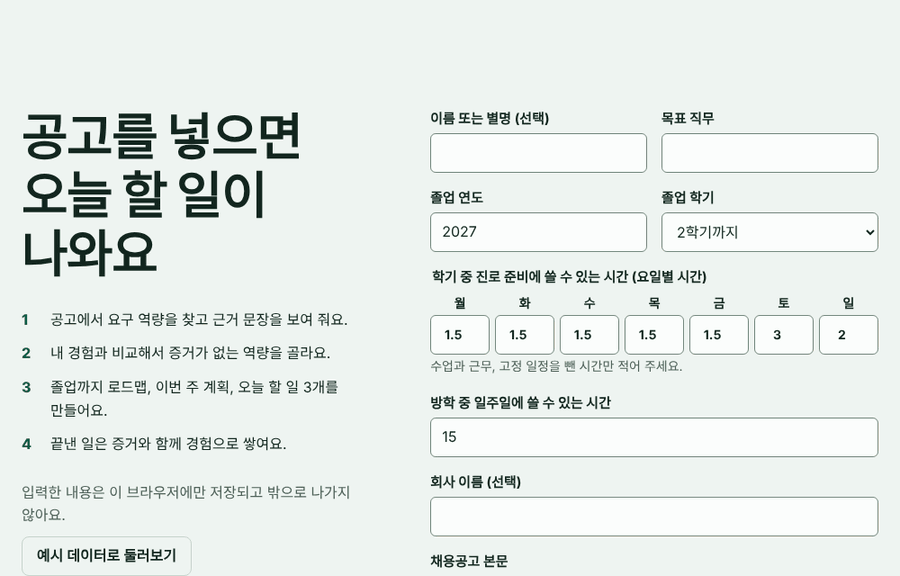

# 📚 DUCK LIBRARY

**Paste job postings, get today's tasks.** DUCK LIBRARY is a second brain for Korean college students, home to the DuckStep career planner.

[한국어](README.md)

**[Open DuckStep](https://dongjushin-ai.github.io/duck-library/)** · No install, no account, no server.



## DuckStep career planner

1. Enter your target role, available hours, and job postings.
2. See required skills with the exact sentence each one came from. Requirements the dictionary cannot read stay visible.
3. Compare them with your experience. A skill counts only when you can link evidence, and there is no fake "chance of passing" score.
4. Get a roadmap to graduation, a weekly plan, and at most three tasks for today, after subtracting exam and assignment prep time.
5. Finish a task with evidence, and your experience bank, skill shelf, and next plan update.

**Your dashboard is your file.** `내 HTML 저장` creates one HTML file containing your data. Open it anywhere to continue.

**Your data stays with you.** There is no backend or analytics, and a strict Content Security Policy blocks outbound requests. Clearing browser data also clears autosave, so keep a saved copy.

Posting analysis uses a Korean rule-based dictionary in [`planner/src/skills.js`](planner/src/skills.js). Pull requests that add skills are welcome.

## Notion second brain

This repository also installs a Notion workspace that turns class and activity notes into portfolio material through RAW → WIKI → OUTPUT. See the [Korean guide](README.md) for setup.

## Development

```text
npm test
npm run planner:build
```

## License

[MIT](LICENSE) · by [DockY](https://github.com/dongjushin-ai)
