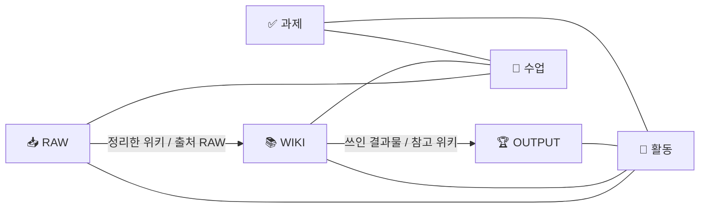

# 📚 DUCK LIBRARY · 대학생 세컨드브레인

수업·과제·활동에서 나오는 기록을 **RAW → WIKI → OUTPUT** 3단계로 바꿔서, 학기가 끝날 때 **포트폴리오와 이력서 재료가 남는** 대학생용 Notion 작업실이에요.

이 저장소는 그 작업실을 **내 Notion에 명령 한 줄로 설치**해 줍니다. 템플릿 복제와 달리 DB 이름·속성·관계·수식이 전부 코드로 적혀 있어서, 내 학교·전공에 맞게 고쳐서 설치할 수도 있어요.

```
📥 RAW (줍줍 상자)  →  📚 WIKI (오리 도서관)  →  🏆 OUTPUT (포트폴리오 진열장)
 떠오를 때마다 던지기     일주일에 한 번 내 말로 정리     활동이 끝나면 이력서·자소서 재료로
```

## 설치하면 생기는 것

| DB | 하는 일 | 자동으로 계산되는 것 |
| --- | --- | --- |
| 🏫 수업 · 강의실 | 학기별 과목, 교수, 시간·장소, 성적 | 남은 과제 수, RAW 수, 위키 수 |
| ✅ 과제·할 일 · 퀘스트 | 과제·시험·팀플·발표 마감 | D-day (오늘 🔥, 지나면 ⚠️) |
| 🧭 활동 · 모험 기록 | 동아리·공모전·인턴·프로젝트 | 포트폴리오 준비도 ✏️ → 📥 → 📚 → 🏆 |
| 📥 RAW · 줍줍 상자 | 강의 메모·회의록·아이디어를 정리 없이 | 7일 넘게 미정리면 ⏰ 알림 |
| 📚 WIKI · 오리 도서관 | RAW를 내 말로 다시 쓴 주제별 노트 | 최근 수정 |
| 🏆 OUTPUT · 포트폴리오 진열장 | 포트폴리오 카드·이력서 한 줄·자소서 문단 (S·T / A / R) | — |

여기에 더해 **홈 화면**(3분 시작 안내, 바로가기 카드, 다가오는 마감·정리 기다리는 RAW 등 보기 6개), **시작 가이드** 페이지, 흐름을 눌러 볼 수 있는 **예시 20행**이 함께 만들어져요.

DB끼리는 양방향으로 9쌍이 연결돼 있어요.



## 설치 (10분)

필요한 것: [Node.js](https://nodejs.org) 18 이상, Notion 계정 (무료 플랜도 돼요)

### 1. Notion 통합 만들기

1. [notion.so/profile/integrations](https://www.notion.so/profile/integrations)에서 **새 통합**을 만들어요. 이름은 `DUCK LIBRARY 설치` 처럼 아무거나.
2. 종류는 **내부(Internal)**, 워크스페이스는 설치할 곳으로 골라요.
3. 기능(Capabilities)에서 **콘텐츠 읽기·업데이트·삽입**을 켜요.
4. **내부 통합 시크릿(토큰)**을 복사해 둬요. `ntn_`으로 시작해요.

### 2. 설치할 페이지 준비

1. Notion에서 빈 페이지를 하나 만들어요. (예: `대학 생활`)
2. 페이지 오른쪽 위 `⋯` → **연결(Connections)** → 방금 만든 통합을 추가해요.
3. 페이지 URL을 복사해 둬요.

### 3. 설치 실행

```bash
git clone https://github.com/dongjushin-ai/duck-library.git
cd duck-library
npm install
cp .env.example .env        # .env 파일을 열어 NOTION_TOKEN= 뒤에 토큰 붙여넣기
npm run setup -- "https://www.notion.so/내-페이지-URL"
```

1~2분 뒤 `✅ 완료`와 함께 홈 링크가 나와요. 설치한 페이지 아래에 **DUCK LIBRARY | 대학생 세컨드브레인**이 생겨 있을 거예요.

| 옵션 | 뜻 |
| --- | --- |
| `--no-samples` | 예시 20행 없이 빈 작업실만 설치 |
| `--dry-run` | Notion에 아무것도 보내지 않고 설치 과정만 점검 |

> 토큰은 내 컴퓨터의 `.env`에만 저장되고, 스크립트는 Notion 공식 API 말고 다른 곳으로 아무것도 보내지 않아요. 설치가 끝나면 통합을 삭제해도 작업실은 그대로 남아요.

## 처음 쓰는 법

**첫날에는 세 가지만 하세요.** 이번 학기 수업 등록 → 지금 하는 활동 1개 등록 → 오늘 들은 강의나 회의를 RAW에 한 줄.

- **매일** · 떠오르는 건 RAW에 제목 한 줄 + 수업/활동 연결만.
- **매주 15분** · 홈의 `📥 정리 기다리는 기록`을 열어 같은 주제끼리 WIKI 노트 하나로 묶고, RAW의 `정리 상태`를 바꿔요. 목록이 비면 끝!
- **활동이 끝나면** · OUTPUT에 포트폴리오 카드를 만들고 상황(S·T) → 내 행동(A) → 결과(R)를 숫자로 채워요.

자세한 루틴과 자주 묻는 질문은 설치된 **시작 가이드** 페이지에 있어요. `(예시)`가 붙은 행은 둘러본 뒤 지워 주세요.

## 내 마음대로 고치기

모든 구조는 [`schema/duck-library.json`](schema/duck-library.json) 한 파일에 있어요.

- **선택지 바꾸기** · `구분`, `종류`, `핵심 역량` 같은 선택지를 내 전공에 맞게 고쳐요.
- **속성 더하기** · DB의 `properties`에 한 줄 추가하면 돼요. 형식은 [Notion API 속성 문서](https://developers.notion.com/reference/property-object)와 같아요.
- **이름 바꾸기** · 속성 이름을 바꾸면 그 이름을 쓰는 `relations`·`rollups`·`formulas`·`homeSections`도 같이 바꿔 주세요. `npm test`가 틀린 곳을 알려줘요.
- **예시 바꾸기** · [`data/samples.json`](data/samples.json). 날짜는 설치한 날 기준 며칠 전/후 숫자로 적어요.

고친 뒤에는 `npm run dry-run`으로 먼저 점검하세요.

## 문제가 생기면

| 메시지 | 해결 |
| --- | --- |
| `unauthorized` | 토큰이 틀렸어요. `.env`의 `NOTION_TOKEN`을 다시 복사해 붙여넣어요. |
| `object_not_found` / `restricted_resource` | 설치할 페이지에 통합을 **연결**하지 않았어요. 2단계를 다시 확인해요. |
| `⚠️ … 보기는 만들지 못했어요` | 설치는 끝났고, 그 보기만 Notion에서 직접 추가하면 돼요. |
| `⚠️ … 홈 안으로 옮기지 못했어요` | 사이드바에서 `원본 데이터` 페이지를 홈 페이지 안으로 끌어다 놓아요. |
| 중간에 멈춤 | 이미 만들어진 `DUCK LIBRARY` 페이지를 지우고 다시 실행해요. |

그 밖의 문제는 [이슈](https://github.com/dongjushin-ai/duck-library/issues)에 메시지를 붙여 남겨 주세요.

## Notion 템플릿 원본과 다른 점

- 원본 맨 위의 **픽셀 도트 안내 화면**은 들어 있지 않아요. 나머지 구성은 같아요.
- 수식(D-day, 정리 알림, 포트폴리오 준비도)은 원본 가이드에 적힌 동작대로 다시 작성했어요.
- 예시 날짜와 학기는 설치한 날에 맞춰 바뀌어요. 그래서 언제 설치해도 D-day와 ⏰ 알림을 바로 볼 수 있어요.

## 개발

```bash
npm test          # 가짜 Notion으로 전체 설치를 돌려서 원본과 같은 구조인지 검사
npm run dry-run   # 설치 단계만 출력
```

- Notion API 버전 `2026-03-11`, 공식 SDK `@notionhq/client` 5.27.0을 써요.
- 호출 사이에 0.35초 간격을 두고, 429 응답은 `Retry-After`만큼 기다렸다 다시 보내요.
- 코드 구성: `src/setup.js`(설치 순서) · `src/content.js`(홈·가이드 문구) · `src/blocks.js`(블록 도우미) · `src/notion.js`(API 호출) · `src/fake-notion.js`(테스트용 가짜 Notion)

## 라이선스

[MIT](LICENSE) · 만든 사람 [DockY](https://github.com/dongjushin-ai)

자유롭게 쓰고, 고치고, 친구에게 공유해도 돼요. 예시 데이터의 학교·활동·수상 내용은 가상의 값이에요.
